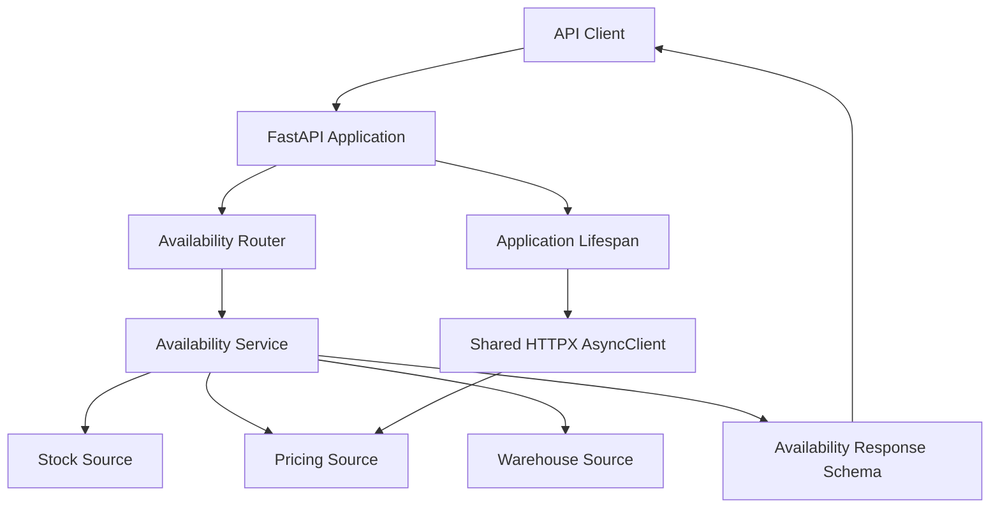

# Inventory Availability API

An asynchronous REST API built with **FastAPI** that aggregates product availability information from multiple sources. For a product, the API gathers stock, pricing, and warehouse availability concurrently and returns a unified response.

> **Project status:** Learning / demonstration project. Some integrations are intentionally represented by placeholders or stub methods. The pricing URL currently uses an example domain, and stock / warehouse methods need real implementations before the service can provide production data.

## Table of Contents

- [Overview](#overview)
- [Features](#features)
- [Architecture](#architecture)
- [Technology Stack](#technology-stack)
- [Project Structure](#project-structure)
- [API](#api)
- [Response Example](#response-example)
- [How Aggregation Works](#how-aggregation-works)
- [Resilience and Concurrency](#resilience-and-concurrency)
- [Setup](#setup)
- [Running the Application](#running-the-application)
- [Testing](#testing)
- [Configuration and Integration Notes](#configuration-and-integration-notes)
- [Potential Improvements](#potential-improvements)
- [License](#license)

## Overview

Inventory Availability API provides a single endpoint that consolidates availability data for a product. Instead of a client independently calling stock, pricing, and warehouse systems, it requests a product's availability from this API.

The service uses asynchronous Python and `asyncio` to execute the underlying data-source calls concurrently. It also applies a shared timeout budget to the aggregation process and includes retry handling for transient pricing-service failures.

## Features

- **Asynchronous REST endpoint** built with FastAPI.
- **Concurrent aggregation** of stock, price, and warehouse availability using `asyncio.gather`.
- **Shared deadline** for the aggregation request to prevent excessively long waits.
- **HTTP client reuse** through a lifespan-managed `httpx.AsyncClient`.
- **Connection pooling** with configurable connection limits.
- **Pricing retry strategy** for selected transient errors, including HTTP 429 and common 5xx responses.
- **Retry-After support** for both delay values and HTTP-date values.
- **Exponential backoff with jitter** to reduce synchronized retries.
- **Concurrency control** for pricing calls using an `asyncio.Semaphore`.
- **Dependency injection** for the HTTP client and availability service.
- **Pydantic response model** for a consistent API contract.
- **Explicit timeout handling** mapped to HTTP 504 Gateway Timeout.

## Architecture

The application follows a small, layered structure that separates HTTP routing, service orchestration, dependencies, schemas, and exception handling.



### Responsibilities

| Component | Responsibility |
|---|---|
| `main.py` | Creates the FastAPI application, initializes the shared async HTTP client during application lifespan, and registers routers. |
| `routers/availability.py` | Defines the HTTP endpoint, calls the service, and translates aggregation timeout exceptions into HTTP responses. |
| `services/availability_service.py` | Orchestrates source calls, concurrency, time budgeting, pricing retries, backoff, and rate/concurrency protection. |
| `dependencies.py` | Provides the shared HTTP client and availability service through FastAPI dependency injection. |
| `schemas/availability_response.py` | Defines the response contract using Pydantic. |
| `exceptions/` | Contains application-specific exceptions, including the availability timeout exception. |

## Technology Stack

| Technology | Purpose |
|---|---|
| Python | Application language |
| FastAPI | API framework and routing |
| asyncio | Asynchronous orchestration and concurrency |
| HTTPX | Async HTTP client, timeouts, connection pooling, and HTTP error handling |
| Pydantic | Response validation and serialization |
| Uvicorn | ASGI server (recommended for running the application) |

## Project Structure

```text
inventory-api-2/
├── exceptions/
│   └── availability_timeout_error.py
├── routers/
│   └── availability.py
├── schemas/
│   └── availability_response.py
├── services/
│   └── availability_service.py
├── dependencies.py
├── main.py
└── README.md
```

*The tree above describes the application modules visible in the repository. Add your dependency manifest, tests, configuration, and deployment files as the project evolves.*

## API

### Get product availability

Retrieves aggregated availability information for a product.

**Endpoint**

```http
GET /products/{product_id}/availability
```

**Path parameter**

| Parameter | Type | Description |
|---|---|---|
| `product_id` | integer | Product identifier |

**Successful response — `200 OK`**

```json
{
  "product_id": 123,
  "stock": 25,
  "price": 49.99,
  "warehouse_available": true
}
```

**Timeout response — `504 Gateway Timeout`**

If the aggregation exceeds the configured deadline, the router returns:

```json
{
  "detail": "Availability aggregation timed out"
}
```

The response body follows FastAPI's standard HTTP exception format.

### Interactive API documentation

FastAPI automatically provides interactive API documentation when the app is running:

- Swagger UI: `/docs`
- ReDoc: `/redoc`
- OpenAPI schema: `/openapi.json`

## Response Example

The response model contains:

| Field | Type | Meaning |
|---|---|---|
| `product_id` | integer | Requested product ID |
| `stock` | integer | Stock quantity returned by the stock source |
| `price` | number | Product price returned by the pricing source |
| `warehouse_available` | boolean | Whether the warehouse source reports availability |

## How Aggregation Works

For a request, the service starts the stock, pricing, and warehouse operations concurrently:

```python
stock, price, warehouse_available = await asyncio.gather(
    self.get_stock(product_id),
    self.get_price(client, product_id, deadline),
    self.get_warehouse_availability(product_id),
)
```

This allows independent operations to overlap rather than waiting for each one sequentially. The aggregation runs within a shared deadline.

### High-level flow

1. The client requests `GET /products/{product_id}/availability`.
2. FastAPI validates the path parameter and resolves injected dependencies.
3. The router delegates the request to `AvailabilityService`.
4. The service creates a deadline for the complete aggregation.
5. Stock, pricing, and warehouse calls are started concurrently.
6. The pricing operation applies retry and concurrency-control policies as needed.
7. If all operations complete, the service creates an `AvailabilityResponse`.
8. If the shared deadline expires, the service raises `AvailabilityTimeOutError` and the router returns HTTP 504.

## Resilience and Concurrency

### Shared aggregation timeout

The aggregation currently uses an **8-second total deadline**. This is a budget for the combined operation, rather than a separate full timeout for each source call.

The deadline is implemented using `asyncio.timeout_at`, based on the event loop's monotonic clock.

### Pricing retry policy

The pricing integration currently defines:

- Maximum attempts: **3**
- Base retry delay: **0.25 seconds**
- Exponential backoff
- Random jitter
- Support for the HTTP `Retry-After` header
- Retryable HTTP status codes: `429`, `500`, `502`, `503`, and `504`
- Retries for network errors and HTTPX timeout exceptions

Non-retryable HTTP status codes are raised immediately. Before sleeping, the service checks whether the proposed delay would exceed the remaining aggregation deadline.

### Pricing concurrency limit

A shared `asyncio.Semaphore` limits concurrent pricing operations to **10**. This helps prevent excessive pressure on the pricing dependency when multiple API requests are being processed.

### HTTP connection pooling

The application creates a shared `httpx.AsyncClient` during its lifespan and closes it when the application shuts down.

Current pool settings:

| Setting | Value |
|---|---:|
| Maximum connections | 100 |
| Maximum keep-alive connections | 20 |

Current HTTPX timeout settings:

| Timeout | Value |
|---|---:|
| Connect | 2 seconds |
| Read | 5 seconds |
| Write | 3 seconds |
| Pool | 1 second |

## Setup

### Prerequisites

- Python 3.12+ recommended
- `pip`
- Git
- A virtual environment
- Uvicorn for running the ASGI application

> The repository's dependency files and supported Python version should be checked before installation; this README uses the standard virtual-environment workflow.

### 1. Clone the repository

```bash
git clone https://github.com/NeckerFree/inventory-api-2.git
cd inventory-api-2
```

### 2. Create and activate a virtual environment

**Windows PowerShell**

```powershell
python -m venv .venv
.venv\Scripts\Activate.ps1
```

**Linux / macOS**

```bash
python -m venv .venv
source .venv/bin/activate
```

### 3. Install dependencies

Install the project's dependency list if one is present (for example, `requirements.txt`):

```bash
pip install -r requirements.txt
```

If the repository does not yet include a dependency manifest, install the core runtime packages:

```bash
pip install fastapi httpx uvicorn
```

## Running the Application

From the repository root, start Uvicorn:

```bash
uvicorn main:app --reload
```

If the app is configured to use a different host or port, adjust the command accordingly. The default Uvicorn port is `8000`.

Open the documentation:

- http://127.0.0.1:8000/docs
- http://127.0.0.1:8000/redoc

### Example request

```bash
curl http://127.0.0.1:8000/products/123/availability
```

## Testing

Automated tests are recommended for the following behaviors:

- Successful aggregation of stock, pricing, and warehouse data.
- Concurrent execution of source calls.
- Aggregation deadline and timeout mapping to HTTP 504.
- Pricing retries for retryable HTTP status codes.
- No retries for non-retryable HTTP status codes.
- Retry behavior for network and timeout exceptions.
- Parsing numeric and HTTP-date forms of `Retry-After`.
- Exponential backoff and jitter.
- Pricing semaphore concurrency limit.
- HTTP client dependency and service dependency overrides.
- Response schema validation.

A suggested test stack is `pytest`, `pytest-asyncio`, and `httpx` (including FastAPI's test client or async test support).

## Configuration and Integration Notes

The current implementation is a learning/demo foundation and should be reviewed before production use.

- The pricing integration currently targets `https://pricing.example.com/products/{product_id}`. This is a placeholder URL and must be replaced with a real pricing service.
- `get_stock()` and `get_warehouse_availability()` are stub methods and need implementation.
- External service authentication, configuration, and secrets management are not implemented in the visible code.
- The API currently exposes a single aggregation endpoint and does not include a persistence layer.
- Add structured logging, metrics, and tracing before using the service in a production environment.
- Review the retry policy with the upstream service's rate limits and reliability contract.

## Potential Improvements

Possible next steps:

- Implement stock and warehouse integrations.
- Move external URLs and timeout/retry values into environment-based settings.
- Add automated tests with mocked external dependencies.
- Add structured logging and request correlation IDs.
- Add OpenTelemetry tracing and metrics for each dependency.
- Add circuit breakers or dependency-health tracking.
- Add caching where product availability freshness requirements permit it.
- Add Docker packaging and a CI pipeline.
- Add authentication and authorization if the endpoint requires access control.
- Document upstream API contracts and error mappings.
- Add API versioning and consistent error response schemas.

## License

No license file is currently documented here. Add a `LICENSE` file and update this section if you intend to distribute the project under a specific open-source license.
